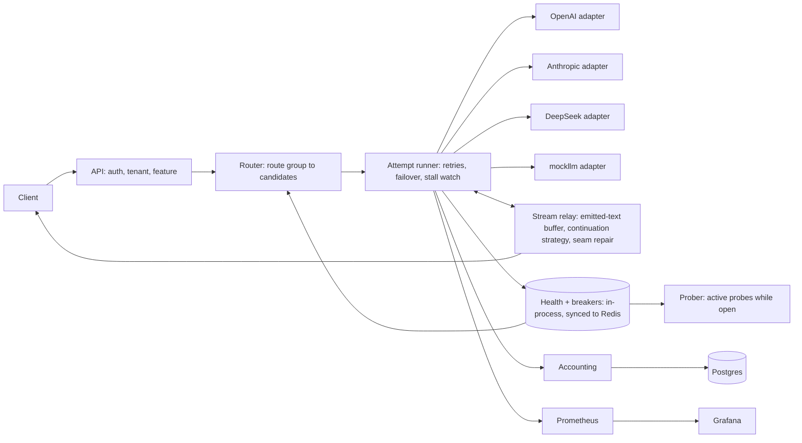
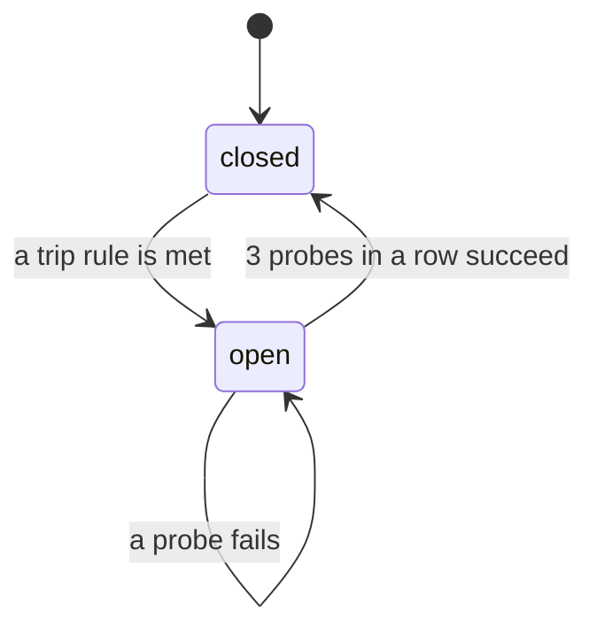

# Switchyard: spec

Status: v2.2, week 3 done · Owner: Zhan Kuatuly · Last updated: 2026-10-28 · Changes from v1 are listed in section 21.

## 1. Summary

Switchyard is an LLM gateway that keeps answers flowing when providers fail, and measures how well each way of finishing a broken answer actually works.

Clients send OpenAI-style requests to one endpoint. Switchyard picks a provider, tracks its health, and fails over when it degrades. When a provider dies halfway through a streamed answer, Switchyard finishes the answer on another provider using the continuation strategy that measured best for that provider pair. Every request is attributed to a tenant and a feature, with its cost.

The headline is the measurement, not the feature. The README will open with a line like this, filled in from real results:

> When a provider dies mid-answer, how well can another model finish it? Across N cuts and 6 provider pairs, instructed continuation with seam repair read as seamless X% of the time (95% interval a to b), against Y% for restarting the answer and Z% for native continuation. Switchyard uses the best strategy per pair and served P% of requests through 5 scripted outages.

## 2. Where this stands

Dated 2026-10-22. Re-check every claim in this section in the month the results are published, and date them in the README.

- **API7's AISIX gateway** already continues a broken stream on a fallback model. It sends the original messages, an instruction not to repeat, and the delivered text as a trailing assistant message, and it skips continuation for tool calls, reasoning and structured output.
- **LiteLLM** used to do the same with an assistant prefill. That returned a 400 on Claude 4.6 and later, so its chat completions endpoint now re-raises the error once any content has streamed (the maintainer says v1.97.0 or later). Its `/v1/responses` endpoint still resumes mid-stream.
- **LLM Gateway** says the error reaches the client once data has been sent.

So mid-stream continuation exists. What nobody publishes is how good the joins are: how often a reader can tell the answer was interrupted, by strategy and provider pair, and what each failover costs. That measurement, and an open harness anyone can rerun, is Switchyard's contribution.

### 2.1 What it proves

- **Reliability engineering for LLMs:** circuit breakers with active probes, retry budgets, failover, stall detection and cost attribution. These are standard system design interview topics.
- **Current provider knowledge:** the Claude 4.6 prefill change, DeepSeek's beta prefix completion and keep-alive comments, usage missing on cut streams, error events inside a 200 stream, all pinned by contract tests on recorded real streams.
- **Honest evaluation:** a seam-quality table with confidence intervals, judges from three model families with a neutral judge for every pair, checked against hand labels, and the misses published.
- **A foundation:** Threadline, Groundtruth, Rowcall, Casefile and Slotfill send their model calls through Switchyard, so its dashboard fills with real traffic and real cost per project as they get built.

### 2.2 How it differs from Dastar

[Dastar](https://github.com/Zhan017/dastar) proves correctness inside one database. Switchyard proves resilience across unreliable networks and providers. Switchyard deliberately leaves out what Dastar already shows:

| Already shown or planned in Dastar | What Switchyard does instead |
| --- | --- |
| Idempotency keys, a sweeper worker, a planned outbox publisher with backoff and dead letters | No request queue and no background jobs. When every provider is down, requests fail fast with 503 and `Retry-After` |
| Hashed API keys with capabilities, and admin routes to manage them | Tenants and keys come from the config file. No key-management API |
| Per-key rate limits, per-key token buckets and an LLM daily spend cap | Token limits and dollar budgets are stretch goals, first in line to cut after hedging |
| An open-loop load harness | One small overhead measurement. The outage suite and the seam evaluation are the evidence |
| OTLP traces to Grafana Cloud with token and cost on spans | Prometheus and one Grafana dashboard. Tracing is a stretch goal |
| Invariants enforced by Postgres | Postgres only stores request and attempt records |
| TypeScript | Python |

The two repos share conventions on purpose: the same verdict exit codes (0 pass, 1 fail or invalid run, 2 usage error, 3 inconclusive), a LIMITATIONS file and ADRs. The subjects differ: network faults and seam quality here, database faults and agent claims there.

They connect through one integration. Dastar's agent milestone plans an Anthropic adapter first and an OpenAI-compatible adapter second, so Dastar can route through Switchyard once its second adapter exists. Dastar's design also plans its own LLM circuit breaker. When Dastar routes through Switchyard, Dastar keeps only a request timeout, so two breakers don't stack and trip on each other's 503s.

## 3. Decisions

| Decision | Choice | Why | What it costs |
| --- | --- | --- | --- |
| Language | Python 3.12, FastAPI, asyncio | Main stack, fastest to ship, matches the other five projects | Overhead in milliseconds, not microseconds |
| Provider access | Own adapters over aiohttp | Full control of streams, required for continuation strategies; httpx used about twelve times the CPU per stream (decision 4) | Fewer providers |
| Providers in v0.1 | OpenAI, Anthropic and DeepSeek, plus `mockllm` | Three families for the seam pairs and the judges; DeepSeek is the only hosted API with documented native continuation; its API is OpenAI-compatible, so the adapter is small | No local model until stretch |
| Headline | Measured comparison of continuation strategies | The feature exists elsewhere; the measurement doesn't | The result may be negative, and is published either way |
| JSON answers | Buffer the whole answer; on failure, restart cleanly on the next provider | A continued JSON fragment can't be validated, and JSON clients rarely need token streaming | No streaming for JSON requests |
| Judges | One OpenAI, one Anthropic and one DeepSeek model, each judging every item, checked against 50 hand labels | Every pair gets at least one judge from outside both of its families, and self-preference is measured instead of hidden | Three times the judge cost, capped in 12.2 |
| Order of work | Seam test on real providers in week 1, before gateway work | The headline risk is found out first | Gateway work starts a week later |
| Targets | Pass when the lower bound of the 95% interval clears the target | A flat 99.5% on 100 requests is decided by one failure | Larger request counts per scenario |
| Reasoning models | Not in v1 route groups | Their long silent thinking looks like a stall | Fewer models covered |
| Baseline | LiteLLM's proxy, pinned, two configs, both endpoints | Answers "why not LiteLLM?" fairly | LiteLLM must be configured and described fairly |
| Shared state | Redis, synced in the background every 0.5 s, with an in-process copy | Breakers shared across replicas; no Redis call on the request path; no single point of failure | Replicas agree within about 0.5 s, not instantly |
| Non-streaming requests | Read from the provider as a stream (decision 5) | First-token and stall limits catch a hung provider on every request, not only streamed ones | About 4 ms more at 100 req/s against mockllm, from reading the stream; see 13 |
| Durable records | Postgres | Request and attempt records; cost queries | Write volume, handled by batching |
| Config | YAML validated with Pydantic, hot reload | Policy changes without a deploy | |
| Deployment | Local Docker Compose plus a recorded video | No hosting cost | No public live demo |
| Overlap with Dastar | Section 2.2 | The two repos should show different skills | Some realism lost; the README says why |

## 4. Scope

### v0.1 (ship first)

- `POST /v1/chat/completions` in OpenAI format, streaming and non-streaming, for text and JSON answers. Tool calls pass through with the rules in 7.6.
- Adapters for OpenAI, Anthropic and DeepSeek, plus `mockllm`.
- Health tracking, circuit breakers with active probes, same-provider retries with a retry budget, failover down a route group, stall detection.
- Mid-stream failover with the strategies in 7.6, and seam repair.
- Tenants and features from config; cost per tenant, feature and provider, with estimated usage for cut streams.
- Prometheus metrics and one Grafana dashboard.
- `mockllm` and the `switchyard-chaos` scenario CLI.
- Scenarios S1, S4, S5, S6 and S8.
- The seam evaluation on real providers, and the LiteLLM baseline.
- README, one diagram, a 90-second video, LIMITATIONS, ADRs.

### v1 (after v0.1 ships)

- Scenarios S2, S7 and S10 (Redis unavailable).
- The full seam evaluation: 200 prompts, all three judges, 50 hand labels.
- Tool-call failover rules covered by contract tests on recorded streams.

### Stretch (in this cut order: the first item is the first to drop)

1. Hedged requests and S3.
2. Dollar budgets, token-per-minute limits and S9.
3. OpenTelemetry tracing.
4. The chaos proxy in front of real providers (use recorded real streams replayed by `mockllm` instead).
5. A local provider (Ollama or vLLM).
6. Tool-call continuation across a mid-stream failover (v0.1 ends the stream cleanly instead).
7. A k6 load test beyond the one overhead measurement.
8. A blog post (the README results section is enough).
9. AISIX as a second mid-stream baseline; a semantic cache.

Never cut: the seam evaluation, the strategy comparison, S5 and S6 on real providers, the LiteLLM run and the "What didn't work" section.

### Not in scope

Embeddings, images, audio, multi-region, an admin UI beyond Grafana, a hosted demo, and reasoning models in v1 route groups.

## 5. Architecture



| Component | Responsibility |
| --- | --- |
| API | Parse OpenAI-format requests, authenticate the tenant key, check the feature against the tenant's list, assign a request id |
| Router | Turn a route group into an ordered candidate list; skip open breakers, cooldowns and models missing a needed capability |
| Attempt runner | Run attempts with deadlines, same-provider retries, failover and stall detection |
| Adapters | Translate the canonical request to each provider's wire format and back; declare capabilities per model |
| Stream relay | Forward chunks, keep the text already sent, run the continuation strategy and seam repair, send heartbeats |
| Health and breakers | Sliding-window stats and breaker state per provider and model, kept in process and synced through Redis |
| Prober | Send small probe requests to open providers and close their breakers on recovery |
| Accounting | Tokens and cost per attempt and request, exact or estimated; batched writes to Postgres |

## 6. API

### 6.1 Chat completions

`POST /v1/chat/completions` takes an OpenAI request body. `model` is a route group alias (for example `chat-smart`) or a concrete `provider/model`.

| Header | Required | Meaning |
| --- | --- | --- |
| `Authorization: Bearer <tenant key>` | Yes | Identifies the tenant |
| `X-Switchyard-Feature` | Yes | Feature name for cost attribution. Must be in the tenant's list in config; any other value is recorded as `other` and counted |
| `X-Request-Id` | No | Generated if absent, echoed in the response |

**Request fields:**

| Field | Behavior |
| --- | --- |
| `n` greater than 1, `logprobs`, audio input or output | Rejected with 400 |
| `seed` | Ignored, because a failover changes the model anyway |
| `stop` | Passed through. A request with stop sequences is never continued mid-stream (a stop sequence could span the join); it gets the error strategy |
| `response_format` (JSON or schema) | The whole answer is buffered; see 7.6 |
| `tools`, `parallel_tool_calls` | Passed through; see 7.6 for failover rules |
| `max_tokens` missing | A default per route group is applied |

**Non-streaming responses** use the OpenAI format plus a `switchyard` object: served provider and model, attempts, failovers, strategy used, `cost_usd` and `usage_estimated`.

**Streaming responses** use OpenAI server-sent events:

- The chunk `id` stays the same for the whole answer. The `model` field shows the route group alias, because the serving model can change mid-answer. The final `switchyard` object names every model that served.
- On a failover Switchyard writes an SSE comment line, which clients ignore: `: switchyard failover from=anthropic/<model> to=openai/<model> at_chars=1234 reason=stall strategy=instructed`.
- While a failover or seam repair is in progress, it sends a `: heartbeat` comment every 3 s, so proxies and clients with idle timeouts don't drop the connection.
- The final chunk carries `usage` (marked estimated when it is) and the `switchyard` summary.

**Errors** use the OpenAI error shape. In a stream, the error is sent as exactly these two events, and a contract test checks that the official OpenAI Python and TypeScript SDKs raise a clean error on them and ignore the comment lines:

```
data: {"error": {"message": "<text>", "type": "switchyard_error", "code": "<code>"}}

data: [DONE]
```

| Code | HTTP | When |
| --- | --- | --- |
| `no_healthy_provider` | 503 + `Retry-After` | Every candidate failed, is open or is cooling down |
| `deadline_exceeded` | 504, or an error event mid-stream | The request deadline passed |
| `upstream_rejected` | 400 | The provider rejected the request as invalid; passed through |
| `content_filtered` | The provider's status | A filter or refusal; passed through, never continued, never failed over |
| `upstream_auth_failed` | 502 | The provider rejected Switchyard's own key; the client can't fix this |
| `invalid_api_key` | 401 | The tenant key is missing or unknown |
| `missing_feature` | 400 | No `X-Switchyard-Feature` header |
| `model_not_found` | 404 | The model is neither a route group nor a configured `provider/model` |
| `unsupported_feature` | 400 | No model in the route supports what the request needs (tools, a JSON mode) |
| `provider_not_configured` | 503 | The models that could serve the request all belong to providers whose API key isn't set |
| `invalid_request` | 400 | The body is invalid, or asks for something rejected in the request fields table |

**Refusals and filters inside a 200 stream** are detected from Anthropic's `stop_reason: refusal` and OpenAI's `finish_reason: content_filter` or `refusal` field. They end the stream as they are.

### 6.2 Operations and admin

Admin endpoints use a separate admin key. Tenants, keys and features live in the config file; changing them is a config edit plus a reload.

- `GET /healthz`, `GET /readyz`, `GET /metrics`
- `GET /admin/providers`: health, breaker state and cooldowns per provider and model
- `POST /admin/providers/{provider/model}/breaker` with `{"force": "open" | "closed" | "auto"}`. Forcing closed also resets the model's window, so returning to `auto` starts clean; the scenario CLI does this before each seed
- `POST /admin/config/reload`

### 6.3 Chaos control (mockllm only)

`POST /chaos` with `{"mode": ..., "params": ..., "duration_s": ...}`.

Modes: `error_rate`, `status` (429 with `Retry-After`, 500, 529), `ttft_ms`, `cut_after_tokens`, `stall_after_tokens`, `malformed_chunk`, `error_event` (an Anthropic-style error event inside a 200 stream), `refuse_connections`, `hang` (accept the connection and never answer), `flap` (with `period_s`), and `replay` (play back a recorded real stream, optionally cut at a given point).

`refuse_connections` and `flap` with `down: refuse` need gate mode (`python -m mockllm --port 8001 --control-port 8101`): an HTTP app can't refuse a TCP connection, so a gate on the public port forwards bytes to the app and closes its listening socket on command. Faults go to the control port. `params.seed` reseeds the random choices, so a seed injects the same failures every run. `GET /stats` counts requests and, separately, probes (`max_tokens: 1`).

## 7. Core behavior

### 7.1 Timeouts

One request class in v0.1. Defaults live in config per route group:

| Setting | Default | Notes |
| --- | --- | --- |
| Request deadline | 120 s | When it passes mid-stream, send the `deadline_exceeded` error event |
| Time to first token | 5 s | Longer than this counts as a failure for health |
| Stall timeout | 5 s between content deltas | Only content deltas reset it. Anthropic `ping` events, DeepSeek `: keep-alive` comments and unknown event types don't |
| Probe timeout | 5 s | See 7.4 |

### 7.2 Route groups and model capabilities

Abridged from `config/switchyard.yaml`:

```yaml
route_groups:
  chat-fast:
    models: [anthropic/claude-haiku-5-5, openai/gpt-6-luna, deepseek/deepseek-flash]
    default_max_tokens: 1024
    # Optional, with these defaults: request_deadline_s 120, ttft_timeout_s 5, stall_timeout_s 5
models:
  anthropic/claude-haiku-5-5:
    sampling_params: false   # Claude Haiku 5.5 rejects temperature, top_p and top_k
    json_object: false       # JSON only with a schema
    continuation: instructed # Claude 4.6 and later reject prefill with a 400
    request_overrides:       # merged into every request body
      thinking: { type: disabled }
  openai/gpt-6-luna:
    request_overrides: { reasoning_effort: none }
  deepseek/deepseek-flash:
    json_schema: false       # json_object only
    continuation: native     # beta prefix completion; the evaluation decides whether to keep it
    request_overrides:
      thinking: { type: disabled }
```

Capability flags default to on: `tools`, `json_object`, `json_schema`, `sampling_params`.

**DeepSeek adapter.** DeepSeek's API is OpenAI-compatible, so its adapter extends the OpenAI one with four differences:

- Every request sets `thinking: {"type": "disabled"}`.
- Native continuation uses the beta base URL (`https://api.deepseek.com/beta`): the partial answer goes in as the last message, with role `assistant` and `prefix: true`. Because the feature is beta, a contract test runs it on every release, and the model falls back to `instructed` if it starts failing.
- While a request waits in DeepSeek's queue, the stream sends `: keep-alive` comments for up to 10 minutes. They don't count as a first token or as content, so the time-to-first-token budget still catches a queued request.
- DeepSeek's limits are on concurrent requests, so its 429s are treated like any other 429 cooldown. Usage reports cache hits and misses separately, priced as cached and uncached input.

`continuation` is `native`, `instructed` or `none`, and the seam evaluation decides each value. Pick the exact models at build time. Cheap models tend to differ most in style, which affects seams, so the evaluation records the models it used.

Candidate selection walks the chain in order. It skips models whose breaker is open, models in a 429 cooldown, and models missing a capability the request needs.

### 7.3 Health tracking

Per provider and model, kept in process and synced to Redis so replicas share it and a restart doesn't reset it:

- 10-second buckets over a 60-second window.
- Counts by outcome: `ok`, `timeout`, `server_error`, `connection`, `stall`, `rate_limited`, `content_filter`, `client_error`.
- Bucketed histograms of time to first token and total latency.

### 7.4 Circuit breaker



- **Trip rules,** any one of:
  - in the last 60 s, at least 10 requests and at least 40% of them failed with retryable errors (below S1's 50% error rate, so S1 trips reliably);
  - 5 retryable failures in a row (so low real traffic can still trip it);
  - p95 time to first token above its budget in two consecutive, non-overlapping 30-second periods, each with at least 10 samples. Periods are aligned to multiples of 30 s and only whole periods count. The budget is the route's first-token timeout, so a sample over budget is a first-token timeout, and the rule reads: more than 5% of attempts timed out before the first token in each of two periods.
- **While open,** no user traffic goes to the provider. The prober sends a tiny request (`max_tokens: 1`) every 10 s, with a 5 s timeout. Three successful probes in a row close the breaker. There is no doubling backoff.
- **Worst-case recovery,** from the moment the provider is healthy again:

  ```
  T_close ≤ P + (k − 1) × P + t_probe = 10 + 20 + 5 = 35 s
  ```

  where `P` is the probe interval, `k` the successes needed and `t_probe` the probe timeout. The S4 and S8 targets are derived from this.
- **Probe cost:** 6 tiny requests a minute per open provider and model, recorded with cost class `probe`.
- **429 with `Retry-After`** is a quota signal, not a health signal. It puts that provider and model in a cooldown until the given time, separate from the breaker, and doesn't count toward the trip rules. A 429 without `Retry-After` cools down for 10 s.
- **Not counted:** client errors (400, 404, 413), content filters and refusals. 401 and 403 mean Switchyard's own key is bad: the model cools down for 60 s, the request fails over, and an error is logged.
- **5 failures in a row** count however far apart they are (nothing succeeded in between), and are counted per replica. A breaker that closes forgets its window, so old failures can't trip it again at once.
- **Shared state:** the request path never calls Redis. Each replica decides from its in-process copy, and a background task syncs every 0.5 s: health counts go into per-bucket Redis hashes and the merged window comes back in one pipelined round trip; a local transition is written with a compare-and-set Lua script on the record's version, and the newer change wins a conflict. One replica probes an open model per round (`SET NX`), and a second Lua script applies the probe result, so the success streak survives a change of prober. If Redis is unreachable, each replica decides from its own copy (fail open) and sends its unsent counts when Redis returns. Cooldowns stay per replica.
- Every transition is logged, counted in metrics, and can be forced from the admin API.

### 7.5 Retries and failover

- **Same-provider retries** happen only before the first token, only for connection errors, timeouts, 5xx and 529, at most once per attempt, with exponential backoff and full jitter (base 200 ms, cap 2 s).
- **Retry budget:** same-provider retries may add at most 20% load to one provider and model, measured over a rolling minute. It protects a struggling provider from being hit again. When it is spent, the runner fails over instead of retrying.
- **Failover** to the next healthy candidate is immediate and is not limited by the retry budget. It is bounded by the attempt cap (3 attempts per request, retries included) and by the breakers. Skipping an open or cooling-down candidate is not an attempt.
- **The retry budget has a floor** of 3 retries per model per minute, so a lone failure at low traffic can still be retried (Finagle's budget has the same floor).
- **Failover kinds:** connection errors, timeouts, stalls, 5xx and error events, malformed chunks and invalid JSON, 429s and bad provider keys. Never a client error (it would fail anywhere) or a missed request deadline.
- **Commit point:** an attempt is committed once the client could see something: the first text or refusal, the first complete tool call, or the end of the answer (for non-streaming requests and JSON, the end, after validation). A failure before that is invisible and fails over; after it, it is a mid-stream failure (7.6).
- **Never fail over a refusal or a content filter.** Sending a refused request to another provider to get around its filter is a policy decision, not a reliability feature.
- A unit test replays S1's arrival pattern against this policy math before any networking exists, and shows S1's target is reachable.

### 7.6 Mid-stream failover

**Goal:** when a stream breaks after the client has received part of the answer, finish it on another provider in the way that reads most seamlessly for that provider pair, and measure how well that worked.

**Strategies** (what the seam evaluation compares):

| Strategy | How it works | Who does this today |
| --- | --- | --- |
| E, error | Stop and send the error event | LiteLLM chat completions (v1.97 and later), LLM Gateway |
| R, restart | Start the answer again from the top on the fallback; the client sees the beginning twice | The restart approach some gateways use |
| N, native continuation | The partial answer goes in as a trailing assistant message and the model continues it. vLLM needs `continue_final_message: true` and `add_generation_prompt: false`. DeepSeek documents it as beta prefix completion (`prefix: true`). Claude 4.6 and later reject it with a 400. OpenAI accepts a trailing assistant message but has no documented continuation, so the model may start a new reply | AISIX; LiteLLM before v1.97 |
| I, instructed | The original messages, then an assistant message with the full partial answer, then a user message: "Your previous message was cut off. Continue from exactly where it stopped. The last characters were: «last 200 characters». Output only the continuation." This is the pattern Anthropic documents for Claude 4.6 and later, and it also works on OpenAI | Not documented by any gateway checked |
| I+S, instructed with seam repair | I, plus the seam repair below | Switchyard |
| A, anchored | The partial answer is quoted inside the user turn instead of being presented as the model's own earlier turn, and the model is asked to start by copying its last few words. Seam repair then cuts at the copied text, so the join point is exact. Added after the first week 1 run, where Claude refused 6 of 30 instructed continuations of GPT's text, saying it had no record of writing it | Switchyard |

The production default per model is the strategy that measures best, set through `continuation` in config.

**Flow**

1. The relay keeps `emitted_text` (what the client already received) and the type of content block in progress.
2. A failure is detected: a provider error event inside a 200 stream (Anthropic sends `event: error` with `overloaded_error`), a dropped connection, an invalid chunk, or a stall. Unknown event types are ignored, as Anthropic's docs ask.
3. If nothing has been sent yet, it's an ordinary failover (7.5).
4. Otherwise, pick the next candidate and build the request for the configured strategy. `max_tokens` is reduced by the tokens already sent.
5. Send `: heartbeat` comments every 3 s until the continuation's first content is ready.
6. Run seam repair, then forward. Write the failover comment, keep the same chunk `id`, sum usage across attempts, and record each attempt's cost.
7. Allow at most 2 mid-stream failovers per request. If all fail, send the error event.

**Seam repair**

Implemented in `src/switchyard/streaming/seam.py`, in this order. Rules marked *(run 1)* were added after reading the first week 1 run, and each is pinned by a test built from the real join:

- Detect a meta reply ("I can't pick up mid-sentence from that earlier message") and treat it as a failed attempt, never as text to send. *(run 1)*
- Strip a leading preface ("Sure,", "Continuing:", a leading ellipsis) by a short pattern list.
- Inside an open code fence, strip a restarted fence line (`` ```python ``).
- Remove exact overlap: the longest suffix of `emitted_text`, at least 3 words, that is also a prefix of the continuation, compared without case. With anchored continuation one word is enough, since the copy is expected. If the answer was cut mid-word and the continuation repeats it in full, keep only the rest of that word.
- Remove a restarted line: if the continuation starts the interrupted line again ("    for" then "    for (const x of xs)"), keep only what is new. Short lines count only when they are a list or table marker such as "-", "3." or "|". *(run 1)*
- Remove a paraphrased restart, outside code only: if at least 60% of the cut sentence's words appear in the continuation's first sentence, find where the restatement reaches the cut point (the last three, then two, words the client saw) and keep only what follows. If no such point is found, keep the text and record `paraphrase_suspected`.
- Fix the join: drop doubled spaces or newlines; if a word meets a word, either finish the cut word (when the joined word appears in the prompt or answer, or the cut word ends in a capital as in `HandlerF`) or insert a space; add a space after sentence punctuation outside code. In code, add the missing line break when the continuation starts an indented line, and a space after a keyword, `->`, `,` or a comment marker. In Markdown, fix a bold marker split across the join ("- *" then "**Title**"). *(run 1)*
- Buffer at most the continuation's first sentence or 200 characters, whichever comes first, and record the added delay as seam latency.

**JSON answers.** When `response_format` asks for JSON or a schema, the relay buffers the whole answer and streams nothing until it is complete and valid. Any failure is then a clean failover before the first byte. No JSON answer is ever continued. LIMITATIONS says so, and JSON is reported separately in the evaluation.

**Tool calls**

- Tool-call deltas are forwarded only once a call is complete.
- If at least one complete tool call has been forwarded and the stream then dies, end the stream with `finish_reason: tool_calls` and don't continue. The client will run the tools and call back anyway.
- If the failure is inside the first tool call and no text was sent, it's an ordinary failover.
- If text was sent and a tool call was partial, send the error event.
- Measure how much the buffering delays tool calls.

**Known limits** (these go in the README's tradeoffs section)

- Style can shift when the answer moves to a different provider.
- Continuation may paraphrase or repeat; seam repair reduces this, and the evaluation reports how much.
- A continuation re-sends the whole prompt plus the partial answer as input tokens, so each failover costs extra; the evaluation reports how much.

### 7.7 Cost accounting

- Always send `stream_options.include_usage` upstream to OpenAI and DeepSeek.
- A cut stream usually has no final usage: OpenAI documents that an interrupted stream may miss its usage chunk, and Anthropic's cumulative usage normally arrives near the end. For cut attempts, estimate output tokens with a local tokenizer over the text received, add a stated safety margin, and set `usage_estimated = true`. Exact and estimated cost are reported separately.
- `prices.yaml` holds, per provider and model: input, output, cached-input and cache-write prices per million tokens, long-context price tiers, and an effective date.
- Every attempt has a `role` (primary, retry, failover, continuation, probe) and its tokens are split by `cost_class`: `served`, `wasted` (a failed attempt, or overlap trimmed by seam repair) or `probe`.
- Once a month, compare totals with the providers' billing pages, with an expected error band stated in advance.

### 7.8 Tenants and features

Tenants, key hashes and each tenant's list of features live in `config/switchyard.yaml`. A feature header not on the list is recorded as `other`, so a buggy client can't create unbounded metric series.

### 7.9 When Redis is unavailable

- Breakers and health: each replica decides from its in-process copy (fail open) and resyncs when Redis returns.
- Redis calls for a request are batched into one Lua script where possible, to protect the overhead target.
- S10 tests a 60-second Redis outage (v1).

### 7.10 Config reload

A reload validates the new file first and is refused if it's invalid. Requests in flight finish under the old config. A model removed from config loses its breaker state; a new model starts closed.

## 8. Data model (Postgres)

```
requests(id, tenant, feature, route_group, status, started_at, finished_at,
         ttft_ms, total_ms, served_provider, served_model, strategy,
         input_tokens, output_tokens, cost_usd, usage_estimated,
         failovers, midstream_failovers, seam_latency_ms, seam_action,
         prompt_hash, prompt_chars, response_chars, error_code)
attempts(id, request_id, n, role, provider, model, started_at, ttft_ms, ended_at,
         outcome, input_tokens, output_tokens, wasted_tokens, cost_usd,
         usage_estimated, emitted_chars_before)
breaker_events(id, provider_model, from_state, to_state, reason, at)
```

- Prompts and answers aren't stored by default, only a hash and a length. A tenant can opt in to debug storage.
- Rows are kept 30 days.
- Writes are batched (every second or every 500 rows), so logging never blocks a request. If Postgres is down, metrics keep flowing and dropped rows are counted.

## 9. Observability

**Prometheus metrics** (labels are bounded: tenant and feature come from config, unknown values become `other`):

- `switchyard_requests_total{tenant, feature, route_group, status}`
- `switchyard_attempts_total{provider, model, role, outcome}`
- `switchyard_ttft_seconds`, `switchyard_request_seconds` (histograms by provider)
- `switchyard_gateway_overhead_seconds` (histogram)
- `switchyard_breaker_state{provider_model}` and `switchyard_breaker_transitions_total`
- `switchyard_cooldowns_total{provider_model}`
- `switchyard_failovers_total{from, to, phase, strategy}` where phase is `before_first_token` or `midstream`
- `switchyard_seam_repair_total{action}` where action is `overlap_trimmed`, `paraphrase_trimmed`, `preface_stripped` or `none`
- `switchyard_retry_budget_exhausted_total{provider_model}`
- `switchyard_cost_usd_total{tenant, feature, provider, model, cost_class, estimated}`

**One Grafana dashboard,** provisioned from JSON: requests per second by provider, error rate, p95 time to first token, breaker timeline, failovers with mid-stream shown separately, cost per tenant and feature (served, wasted and probe), and scenario start and end annotations.

**Logs:** JSON, one line per request and one per breaker transition, each with the request id.

## 10. Outage scenarios

**Common rules**

- Each scenario runs with 5 seeds. Every scenario file states its request rate, duration, request count and topology (which upstreams are mock and which are real). Files are in `chaos/scenarios/`.
- **Mock topology:** two `mockllm` servers, one per model in the `mock` route (mock-a first, mock-b second). Each runs behind a TCP gate (`python -m mockllm`), so `refuse_connections` closes a real listening socket and resets open connections, and faults are switched on a separate control port that stays up.
- **Success** means the response completed with `finish_reason` of `stop` or `length` and no error event.
- **Repeated text** means any span of 8 or more tokens in the continuation that also appears in the last 300 tokens of `emitted_text`.
- **Verdict:** pass when the lower bound of the 95% (Wilson) interval clears the target; inconclusive when there are too few samples for even a perfect run to clear it (380 requests for a 99% target). Shares pool all seeds; times (breaker opening and closing, recovery) are judged on the worst seed. A time target on requests ("503 within 1 s") is a share of the requests in its window, with the same lower-bound rule. Exit codes: 0 pass, 1 fail or invalid run, 2 usage error, 3 inconclusive.
- **Requests are judged by when they were sent,** in seconds from the start of traffic. Upstream attempts are counted at the mockllm servers, probes excluded, so the count is the same for any gateway.
- Request lengths come from a synthetic distribution; `mockllm` ignores prompt content, so real prompts only matter for the seam evaluation.
- The scenario files and targets are committed and tagged before the first run, so the history proves they were fixed in advance.

| ID | Release | What happens | Rate and duration | Target |
| --- | --- | --- | --- | --- |
| S1 | v0.1 | Primary returns 500 on 50% of requests | 10 req/s for 120 s, mock upstreams | Success lower bound ≥ 99%; breaker opens |
| S4 | v0.1 | Primary refuses connections for 5 min, then recovers | 10 req/s for 7 min, mock upstreams | Success lower bound ≥ 99%; breaker opens within 10 s; closes within 45 s of recovery (35 s by formula, plus margin) |
| S5 | v0.1 | Primary's stream is cut at a random 20 to 80% of the answer | (a) 5 req/s for 120 s on mocks; (b) recorded real streams, cut and continued on real providers | (a) completion lower bound ≥ 99%. (b) a measurement, not pass or fail: repeated-text rate and seamless rate by strategy |
| S6 | v0.1 | Primary stops sending tokens mid-stream without closing | Same as S5 | Same as S5; stall detected within the stall timeout plus 1 s |
| S8 | v0.1 | All providers fail for 3 min (from 60 s to 240 s), in two variants: refusing connections, and hanging | 10 req/s for 5 min, mock upstreams | Refusing: lower bound ≥ 99% of requests sent during the outage get 503 within 1 s. Hanging: the same within the time-to-first-token budget plus 1 s (6 s), for requests sent from 15 s into the outage; before that, each attempt costs a full 5 s first-token timeout until both breakers open, so the first requests wait up to about 15 s, reported separately. Attempts ≤ 1.2× requests over the whole run. Normal service within 45 s of recovery |
| S2 | v1 | Primary returns 429 with `Retry-After: 30` for 2 min | 10 req/s for 4 min | Success lower bound ≥ 99%; no same-provider retries during the cooldown |
| S7 | v1 | Primary alternates 20 s healthy and 20 s down for 5 min | 10 req/s for 6 min | Success lower bound ≥ 98%; at most 2 breaker transitions per cycle |
| S10 | v1 | Redis unavailable for 60 s | 10 req/s for 3 min | Success lower bound ≥ 99%; breakers keep working from local state |
| S3, S9 | Stretch | Latency spike with hedging; noisy tenant with budgets | | Defined when those features are built |

**`switchyard-chaos` CLI** runs a scenario file against any OpenAI-compatible base URL, switches faults on and off on schedule, records results from the client's side, and writes JSON and a Markdown report. Because it only needs a base URL, the same run works against LiteLLM.

## 11. Baseline comparison

- **LiteLLM,** pinned to the latest release at build time, with the exact version in the results. If a newer release behaves differently by publication, report both.
- **Two configs:** LiteLLM's defaults, and a tuned config whose cooldown, retry and timeout values match Switchyard's as closely as its settings allow. Publish a table mapping each Switchyard policy to the LiteLLM setting used.
- **Both endpoints:** chat completions, and `/v1/responses`, which still resumes mid-stream.
- **Report honestly:** on chat completions, S5 and S6 are reported as "error, by design", not as a loss. LiteLLM's wins (provider coverage, maturity, features Switchyard lacks) come first in the results.
- **Invite review:** open a GitHub discussion on LiteLLM asking for a review of the tuned config, and link it from the results.
- **Same everything else:** scenarios, providers, traffic and hardware. Every config is committed under `baselines/`.

## 12. Seam quality evaluation (the headline)

### 12.1 Week 1 seam test (go or no-go)

A script with no gateway (`eval/seam/spike.py`): 30 prompts and three provider pairs (Claude to GPT, GPT to Claude, Claude to DeepSeek), using `claude-haiku-5-5`, `gpt-6-luna` and `deepseek-flash` with thinking off. Cut each reference answer at a random point and continue it with strategies R, I, I+S and A, plus N on DeepSeek. It prints the joins side by side. Budget: under $5 and 2 to 4 hours.

Go or no-go: if I+S looks clean on most joins, build as planned. If it doesn't, the project still ships, and the headline becomes the honest negative result plus the strategy table.

**Result (2026-10-23): go.** One reader marked joins seamless at the join point: I+S 55 of 90 (61%), DeepSeek native 25 of 30 (83%). Claude refused 6 of 30 continuations of GPT's text, code joins were the weakest, and Markdown markers broke at the join. Seam repair rules and the anchored strategy (A) were added from these joins, so they are validated in the full evaluation, not here. Seam repair is frozen until then. Report: [`eval/seam/results/20261023-050151/report.md`](eval/seam/results/20261023-050151/report.md).

### 12.2 Full evaluation

- **Prompt set:** 200 prompts that need long answers (at least 300 tokens): 50% prose, 30% code, 20% lists and steps. JSON is reported separately, since JSON answers are buffered and restarted.
- **Provider pairs:** Claude to GPT, GPT to Claude, Claude to DeepSeek, GPT to DeepSeek, Claude to Claude, GPT to GPT. N is measured on the DeepSeek pairs.
- **Cuts:** a seeded random point between 20% and 80% of each reference answer, saved with the data.
- **Strategies:** R, N where supported, I, I+S and A, on the same cuts.
- **Primary metric:** per item, a judge sees the uninterrupted reference and the stitched answer in both orders and answers "which one was interrupted and resumed?" The item is seamless if the judge is wrong, or inconsistent across the two orders. Report the seamless rate with a 95% interval.
- **Seam-local view:** the same question on 300 characters either side of the join, so length and style differences elsewhere don't give the answer away.
- **Judges:** one OpenAI, one Anthropic and one DeepSeek model; every item is judged by all three. The headline number for each pair comes only from judges outside both of its families (for Claude to GPT, that's the DeepSeek judge), so every pair has a neutral score. Also report each judge's rate, their agreement, and self-preference: each judge's seamless rate on continuations from its own family against the others. A fourth judge is added only under the rule in section 20.
- **Human check:** hand-label 50 items. Publish judge numbers only if a judge's Cohen's kappa against the hand labels is at least 0.6.
- **Secondary metrics:** a 1 to 5 coherence score; automatic checks for repeated text, preface leaks and length against the reference.
- **Cost:** extra input and output tokens per failover, by strategy.
- **Budget:** estimate the full run's cost from the week 1 run and set a cap before starting. If it's over the cap, run the non-neutral judges on a 25% sample first, then cut prompts per pair to 100, before cutting any pair.
- **Report:** one table of strategy by provider pair, with intervals, seam latency and extra cost.

## 13. Performance targets

- Gateway overhead p95 under 10 ms for non-streaming requests, and under 10 ms added to time to first token when streaming, against `mockllm` with fixed latency at 200 requests per second on one 4-vCPU container.
- Measure this early in week 2, on the first working proxy, so a miss changes the design early instead of the README late.
- Report the maximum requests per second before overhead p95 passes 25 ms.
- **Week 2 result** ([report](docs/results/overhead-2026-10-28.md)), on a shared 2-vCPU machine with mockllm and the load generator on it too, 32-token answers: at 200 streamed requests a second, 1.7 ms at p50 and 2.6 ms at p95 added to time to first token; non-streaming, 1.0 ms and 1.1 ms. p95 passes 25 ms at about 300 a second. The first version, on httpx, collapsed between 150 and 200 a second, which led to decision 4.
- **Week 3 result, on a 4-vCPU GitHub runner** ([report](docs/results/overhead-2026-10-29-4vcpu.md)), mockllm and the load generator on the same runner: at 200 requests a second, 0.96 ms at p95 added to time to first token when streaming and 4.76 ms when not. Both targets are met. p95 passes 25 ms between 350 and 400 requests a second when streaming, and between 450 and 500 when not. Non-streaming costs about 3 ms more than in week 2 because answers are read as streams (decision 5), and past saturation the week 3 code degrades faster than week 2's.
- Be upfront in the README: Go gateways claim microsecond overhead. Switchyard targets milliseconds and competes on behavior under failure.

## 14. Testing

- **Unit** (pytest, Hypothesis):
  - breaker state machine, with property tests
  - the retry budget, including the S1 replay from 7.5
  - seam repair, as a table of cases: exact overlap, paraphrased restarts, prefaces, mid-word cuts
  - price math with estimated usage
  - config validation and reload
- **Contract,** on recorded real streams:
  - Anthropic error events inside a 200 stream, `ping` events, refusals
  - OpenAI tool-call deltas keyed by `index`, the usage chunk, content filters
  - DeepSeek `: keep-alive` comments, beta prefix completion, thinking turned off, cache hit and miss usage
  - the official OpenAI Python and TypeScript SDKs against Switchyard's comments and error event
- **Integration:** `docker compose up`, then the v0.1 scenarios against `mockllm` with shortened durations, in CI.
- **CI** (GitHub Actions): ruff, mypy in strict mode on `src`, unit, contract and integration tests, image build.

## 15. Repository layout

```
switchyard/
  README.md
  SPEC.md
  LIMITATIONS.md
  compose.yml
  Dockerfile
  pyproject.toml
  config/
    switchyard.yaml
    prices.yaml
  src/switchyard/
    api/            routes, schemas, auth
    core/           canonical types, router, retries, failover
    providers/      base.py, errors.py, sse.py, openai.py (OpenAI and DeepSeek), anthropic.py
    resilience/     health.py, breaker.py, prober.py
    streaming/      relay.py, strategies.py, seam.py
    accounting/     pricing.py, usage.py
    observability/  metrics.py, logging.py
    config.py
  src/mockllm/      fake provider with chaos controls (stream replay later)
  chaos/            scenario files, runner CLI, report generator
  eval/seam/        week 1 spike, prompt set, cuts, runner, judges, hand labels
  baselines/        litellm/ configs and compose file
  grafana/          dashboard and provisioning
  tests/            unit/, contract/, integration/, fixtures/
  bench/            gateway overhead benchmark
  scripts/          record_stream.py for contract fixtures
  deploy/           prometheus.yml
  docs/             decisions/, results/
```

## 16. Milestones

Planned in hours, at 10 to 12 hours a week.

| Week | Hours | Milestone | Done when |
| --- | --- | --- | --- |
| 1 | 10 to 12 | Seam test | Done 2026-10-23: [report](eval/seam/results/20261023-050151/report.md) with joins and a go note. The overhead stub moved to week 2 |
| 2 | 10 to 12 | Proxy | Done 2026-10-28: OpenAI, Anthropic and DeepSeek adapters, streaming and non-streaming, tools and JSON; `mockllm` with faults; tenants and features; cost with estimated usage; `/metrics`; first-token, stall and deadline limits; overhead measured; Docker image and compose file; CI green |
| 3 | 10 to 12 | Resilience | Done 2026-10-28: health, breakers with probes, retries, failover, Redis shared state and Postgres records; S1, S4 and S8 pass on mocks, 5 seeds each ([results](docs/results/scenarios-2026-10-28.md)) |
| 4 | 10 to 12 | Mid-stream | First, before mid-stream code: the gateway's first run against the real APIs (streaming, non-streaming, tools, JSON and a probe on each of the three models) and recorded real streams for the contract tests and S5b and S6b. Then strategies, seam repair, tool-call rules, heartbeats; S5 and S6 pass on mocks; the first seam evaluation on real providers, on fresh prompts and including A |
| 5 | 10 to 12 | v0.1 release | LiteLLM baseline with two configs and both endpoints; results tables; README, diagram, video, LIMITATIONS; tag v0.1 |

v0.1 is about 50 to 60 hours. v1 (S2, S7, S10, the full 200-prompt evaluation with hand labels) adds about 20 to 30 hours. Stretch work comes after that, in the cut order from section 4.

## 17. Finish line for v0.1

- [x] The week 1 seam test report is committed, with its go or no-go note
- [ ] S1, S4, S5, S6 and S8 run from one command, with results published as tables and intervals
- [ ] The seam table: strategy by provider pair, with seamless rate, repeated-text rate, seam latency and extra cost
- [ ] LiteLLM compared with two configs on both endpoints, with the version and the settings mapping committed
- [ ] Gateway overhead and maximum requests per second measured
- [ ] Cost per tenant and feature on the dashboard, with estimated and exact cost shown separately
- [ ] 90-second video: healthy traffic, a provider killed mid-answer, the answer finishing on another provider, the breaker opening, then recovery
- [ ] README opens with the headline numbers, credits AISIX and LiteLLM with dates, and has a "What didn't work" section

## 18. Risks

| Risk | Mitigation |
| --- | --- |
| Seam quality turns out poor | Found in week 1; the project still ships with the negative result and the strategy table |
| Competitor behavior changes before publication | Claims are dated and re-checked in the month of publication |
| Judge bias | Three judge families, a neutral judge for every pair, self-preference reported, kappa of 0.6 against hand labels required |
| Provider APIs change (Claude 4.6 already dropped prefill; DeepSeek's prefix completion is beta) | Capability flags per model; contract tests on recorded streams; fall back to instructed continuation |
| Data handling differs by provider | Only synthetic eval prompts and public-data project traffic go through; each route group lists its providers, so one can be left out |
| The LiteLLM comparison looks unfair | Two configs, a published settings mapping, both endpoints, "by design" wording, invited review, wins reported first |
| Self-graded scenarios | Scenarios and targets tagged in git before the first run; confidence intervals; misses published |
| Redis as a single point of failure | In-process fallback; S10 |
| Scope creep | v0.1 is fixed; stretch work follows the cut order in section 4 |
| API spend | `mockllm` for scenarios; real providers for the seam test (under $5), the evaluation and smoke tests |
| Python throughput | Measured in week 1 on a stub; Redis calls batched |
| Repeating Dastar | Section 2.2; review new features against it before adding them |

## 19. Stretch goals

In cut order, first to drop at the top: hedged requests (with a delay from a long baseline window, capped at half the time-to-first-token budget, and only within one route group tier) and S3; dollar budgets and token limits (with a worst-case cost over all allowed attempts, a default `max_tokens`, a local tokenizer with a margin, and UTC periods) and S9; OpenTelemetry tracing; the chaos proxy; a local provider; tool-call continuation; a k6 load test; a blog post; AISIX as a second baseline; a semantic cache.

## 20. Open questions

None open. Decided on 2026-10-29, before any of them could be influenced by results:

- **Route group models.** `chat-fast` is Claude Haiku 5.5, GPT-6 Luna and DeepSeek Flash, in that order, with thinking off: the cheapest current model of each family, chosen in week 1. Later projects add their own route groups when they arrive.
- **LiteLLM version.** The newest release, not a release candidate, on the day the week 5 baseline is set up, pinned by image digest and recorded in the report. On 2026-10-29 that is v1.106.5, released 2026-10-27. Its chat-completions behavior after content has streamed (re-raise, not resume) is checked on the pinned version before the runs. The version doesn't change after results are seen; if a LiteLLM bug spoils a run, both runs are published with the reason.
- **A fourth judge.** Qwen through DeepInfra is added only if one of the three judges fails the kappa gate (below 0.6 against the 50 hand labels). Each judge is the only neutral judge for at least one pair (DeepSeek for Claude to GPT and GPT to Claude, OpenAI for Claude to DeepSeek, Anthropic for GPT to DeepSeek), so a failed judge leaves a pair without a neutral score. Qwen is outside all three families, so it is neutral for every pair, and it must pass the same gate. If it doesn't, the pair is published without a neutral score and says so. Disagreement between the judges is not a trigger by itself: it is expected from self-preference, and it is reported.

## 21. Changes from v1

Made after a review of v1 on 2026-10-22.

- The headline is now a measured comparison of continuation strategies. The claim that popular gateways lack mid-stream continuation was wrong: AISIX does it, and LiteLLM did it and removed it from chat completions.
- The retry budget limits same-provider retries only; failover is bounded by the attempt cap and breakers. The breaker trips at 40%, has a consecutive-failure rule, treats 429 as a cooldown, and recovers through active probes with a stated worst-case time.
- v0.1 is cut to fit 50 to 60 hours, with the seam test in week 1. Hedging, budgets, token limits, tracing, the chaos proxy and the local provider moved to stretch.
- JSON answers are buffered and restarted, never continued. Tool-call failover rules are defined.
- Continuation requests are specified per provider; seam repair handles paraphrased restarts and sends heartbeats.
- Cut streams get estimated usage, flagged as estimated.
- Redis has an in-process fallback. Metric labels are bounded. Scenario targets use confidence intervals, fixed rates and tagged files.
- The LiteLLM comparison uses two configs and both endpoints.
- The seam evaluation uses an interrupted-or-not judgment in both orders, two judges, a seam-local view and a kappa check.

v2.1, the same day:

- DeepSeek added as a third provider. It is the only hosted API with documented native continuation (beta prefix completion), so strategy N gets real data.
- A DeepSeek judge added, so every pair has a judge from outside both of its families.
- Two DeepSeek pairs added (6 in total), the week 1 test covers N, and the full evaluation has a budget cap.
- OpenRouter was considered and left out as a provider, because it falls back between its own upstream hosts and would hide the failures Switchyard needs to see.

After the week 1 seam test, 2026-10-23:

- Week 1 result recorded in 12.1: go.
- Strategy A (anchored) added to the comparison, and seam repair rules added from the run's joins (section 7.6).
- The overhead stub moved from week 1 to early week 2.

After week 2, 2026-10-28:

- Upstream calls use aiohttp instead of httpx: the first overhead measurement collapsed between 150 and 200 streamed requests a second, and httpx used about twelve times the CPU per stream (decision 4).
- Stall detection was built in week 2, not week 3, since the stream watcher needed it anyway.
- The gateway waits for the provider's first event before answering a stream, so failures before the first token get real status codes (decision 2).
- Capability flags split JSON into `json_object` and `json_schema`; `request_overrides` replaces per-provider options such as turning thinking off.
- New error codes in 6.1, including `upstream_auth_failed` for a bad provider key.
- mockllm lives in `src/mockllm`. Postgres records moved to week 3.
- Models whose provider key isn't set are skipped when routing, so a route group works with whichever keys are configured.
- An independent code review found 15 issues; all are fixed and each has a test. The larger ones: a JSON-mode refusal was treated as a provider failure; Anthropic tool calls without arguments streamed as an empty string instead of `{}`; tool history sent to Anthropic without `tools` would be rejected; failed attempts that were never billed were counted as wasted cost; and JSON-mode streams committed to HTTP 200 before the answer was validated.

Week 3, 2026-10-28:

- S8's hanging variant is judged from 15 s into the outage. Until both breakers open, each attempt costs a full 5 s first-token timeout, so the first requests wait up to about 15 s; the old target could not be met by any design with these timeouts. Those requests are reported separately.
- Time targets on requests ("503 within 1 s") are shares with the 95% lower-bound rule, like the success targets. Inconclusive means too few requests for a perfect run to pass.
- Non-streaming requests are read from the provider as a stream, so first-token and stall limits apply to them (decision 5). Measured cost: about 4 ms more at 100 req/s against mockllm.
- The request path never calls Redis: replicas sync every 0.5 s in the background (decision 6). The consecutive-failure rule and cooldowns are per replica.
- Every upstream call counts toward the 3-attempt cap, retries included. The retry budget has a floor of 3 per model per minute. A 429 without `Retry-After` cools down for 10 s; a 401 or 403 cools down for 60 s and fails over.
- With the budget equal to the first-token timeout, trip rule 3 means more than 5% first-token timeouts in two whole 30 s periods with at least 10 samples each.
- mockllm runs as two servers behind TCP gates, so `refuse_connections` is a real refused connection. `flap` and `replay` added.
- Results: S1, S4, S8-refuse and S8-hang all pass with 5 seeds ([results](docs/results/scenarios-2026-10-28.md)). The one S4 miss is a stream cut mid-answer, left for week 4.
- Scenario attempts are counted at the gateway when it is Switchyard: a mock can't count a connection it refused. Against another gateway the mock-side count is used and the report says so.

Decisions, 2026-10-29:

- Decision 5 stays: answers to non-streaming requests are still read as streams, with no per-route switch. On a 4-vCPU runner it costs about 3 ms and the non-streaming target is met (4.76 ms at p95 at 200 requests a second).
- The three open questions in section 20 are closed: route group models as chosen in week 1, a rule for pinning the LiteLLM version, and a rule for when a fourth judge is added.
- Week 4 starts with the gateway's first run against the real APIs and with recorded real streams, before any mid-stream code. Until then every gateway test runs against mocks or hand-written fixtures; only the week 1 seam test, which has its own clients, has called the real APIs.
- OpenAI cache-write tokens are now counted (`prompt_tokens_details.cache_write_tokens`, billed at 1.25 times the input rate on GPT-5.6 and later).
- Overhead is measured on GitHub's 4-vCPU runners for public repositories (`.github/workflows/bench.yml`), the machine size section 13 names, with a baseline commit measured right after on the same runner.

## References

- Anthropic, Streaming messages: error events, `ping`, cumulative usage, error recovery for Claude 4.5 vs 4.6 and later: https://platform.claude.com/docs/en/build-with-claude/streaming
- Anthropic, Using the Messages API: prefill not supported on Claude 4.6 and later: https://platform.claude.com/docs/en/build-with-claude/working-with-messages
- OpenAI, Chat completions API reference: chunk fields, the usage chunk, usage missing on interrupted streams, tool-call deltas: https://developers.openai.com/api/reference/resources/chat
- DeepSeek, Chat Prefix Completion (Beta): https://api-docs.deepseek.com/guides/chat_prefix_completion
- DeepSeek, Create chat completion (models, thinking mode, `stream_options`, cache usage fields): https://api-docs.deepseek.com/api/create-chat-completion
- DeepSeek, Rate limit (`: keep-alive` comments, 10-minute queue limit, concurrency limits): https://api-docs.deepseek.com/quick_start/rate_limit
- OpenRouter, API reference (prefill, fallback between upstream providers): https://openrouter.ai/docs/api/reference/overview/
- vLLM, OpenAI-compatible server (`continue_final_message`): https://docs.vllm.ai/en/latest/serving/online_serving/openai_compatible_server/
- Ollama, OpenAI compatibility: https://docs.ollama.com/api/openai-compatibility
- API7 AISIX, Mid-stream fallback: https://docs.api7.ai/ai-gateway/routing/mid-stream-fallback
- LiteLLM issue #27967 (prefill-based mid-stream fallback, 400 on Claude 4.6 and later): https://github.com/BerriAI/litellm/issues/27967
- LiteLLM PR #34627 (chat completions re-raise once content has streamed; `/v1/responses` still resumes): https://github.com/BerriAI/litellm/pull/34627
- LiteLLM, Proxy reliability docs: https://docs.litellm.ai/docs/proxy/reliability.md
- LLM Gateway, How we handle LLM provider failover: https://llmgateway.io/blog/how-we-handle-llm-provider-failover
- Dastar README and system design: https://github.com/Zhan017/dastar
