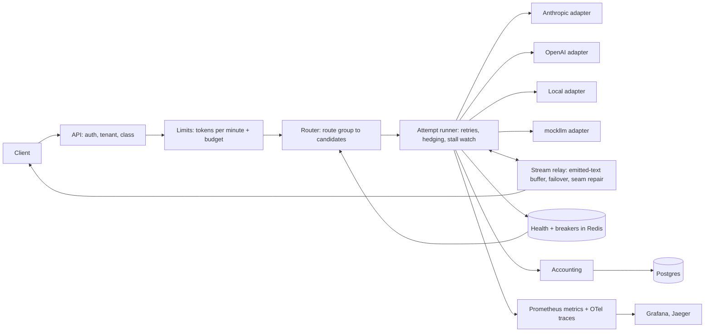
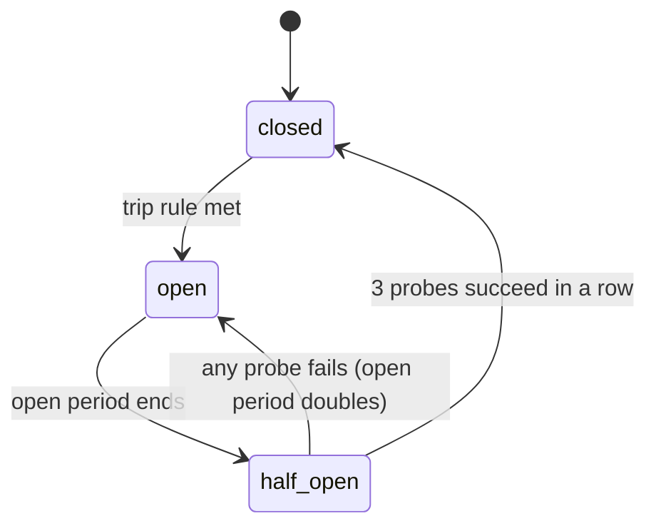

# Switchyard: spec

Status: draft v1 · Owner: Zhan Kuatuly · Last updated: 2026-10-19

## 1. Summary

Switchyard is an LLM gateway that keeps answers flowing when providers fail, including when a provider dies halfway through a streamed answer.

Clients send OpenAI-style requests to one endpoint. Switchyard picks a provider, tracks its health, and fails over when it degrades. If a stream breaks mid-answer, Switchyard continues the same answer on another provider from where it stopped. Every request is attributed to a tenant and a feature, with its cost.

The README will open with this line, filled in from real results:

> Under 9 scripted provider outages, Switchyard served X% of interactive requests. When a provider died mid-answer, it finished Y% of answers on another provider with no visible error, compared with Z% for LiteLLM's proxy under the same tests.

## 2. What it proves

- **Reliability engineering for LLMs:** circuit breakers, safe retries, backpressure, tail latency and cost attribution. These are standard system design interview topics.
- **A feature popular gateways lack:** mid-stream continuation. LLM Gateway says it cannot switch providers once the client has partial data. Portkey falls back but restarts the answer from the first token.
- **An honest comparison:** the same outage suite runs against LiteLLM's proxy, with versions and configs published.
- **A foundation:** Switchyard is the first project. Threadline, Groundtruth, Rowcall (the text-to-SQL agent), Casefile and Slotfill send their model calls through it, so its dashboard fills with real traffic and real cost per project as they get built.

### 2.1 How it differs from Dastar

[Dastar](https://github.com/Zhan017/dastar) proves correctness inside one database: no double booking under races, idempotent retries, background jobs, hashed keys with capabilities, and load and exhaustion measurements. Switchyard proves resilience across unreliable networks and providers: health tracking, circuit breakers, hedging, retry budgets and finishing a broken stream. The two repos should show different skills, so Switchyard deliberately leaves out what Dastar already shows:

| Already shown in Dastar | What Switchyard does instead |
| --- | --- |
| Idempotency keys with stored outcomes, a sweeper worker, and a planned outbox publisher with backoff and dead letters | No request queue and no background jobs. When every provider is down, requests fail fast with 503 and `Retry-After` |
| Hashed API keys with capabilities and venue scope, plus admin routes to manage them | Tenants and their keys come from the config file. No key-management API |
| Planned per-key request rate limits | Only LLM-specific limits: tokens per minute and dollar budgets |
| An open-loop load harness with seeded arrival plans, saturation and pool-exhaustion runs | One small overhead measurement. The outage suite is the evidence |
| Invariants enforced by Postgres | Postgres only stores request and attempt records |
| TypeScript | Python |

They connect through one integration. Dastar's agent milestone plans an OpenAI-compatible provider adapter and its own LLM circuit breaker. Pointing that adapter at Switchyard makes Dastar Switchyard's first real client and keeps provider failover out of Dastar.

The two repos keep the same evidence conventions on purpose: the same verdict exit codes (0 pass, 1 fail or invalid run, 3 inconclusive), a LIMITATIONS file and ADRs.

## 3. Decisions (made 2026-10-19)

| Decision | Choice | Why | What it costs |
| --- | --- | --- | --- |
| Language | Python 3.12, FastAPI, asyncio | Main stack, fastest to ship, matches the other five projects | Overhead in milliseconds, not microseconds. Don't compete on raw speed. |
| Provider access | Own adapters over httpx | Full control of streams, required for continuation, avoids the "wrapper around LiteLLM" look | Four providers instead of a hundred |
| Headline feature | Mid-stream failover | Rare and measurable | Continuation quality varies by provider |
| Baseline | Same outage suite against LiteLLM's proxy | Answers "why not LiteLLM?" with data | LiteLLM must be configured fairly |
| Shared state | Redis | Atomic counters; breaker state shared across replicas | One more service |
| Durable records | Postgres | Request, attempt and job records; cost queries | Write volume, handled by batching |
| Config | YAML validated with Pydantic, hot reload | Policy changes without a deploy | |
| Deployment | Local Docker Compose plus a recorded video | No hosting cost | No public live demo in v1 |
| Overlap with Dastar | No request queue, no key-management API, no generic request rate limits, a small load test only | Dastar already shows these; the two repos should show different skills | Some realism lost; the README says why |

## 4. Scope

### In v1

- `POST /v1/chat/completions` in OpenAI format: streaming and non-streaming, text and tool calls.
- Providers: Anthropic, OpenAI, one OpenAI-compatible local server (Ollama on the Mac for development, vLLM optional), and `mockllm`.
- Health tracking, circuit breakers, retries with a retry budget, fallback chains per request class, stall detection.
- Mid-stream failover for text.
- Hedged requests for the `interactive-fast` class.
- Tenants and keys defined in config; per-tenant token-per-minute limits and dollar budgets.
- Cost per tenant, feature and provider, including tokens wasted on failed attempts and hedges.
- Prometheus metrics, OpenTelemetry traces, Grafana dashboards stored as code.
- A chaos toolkit (`mockllm` plus a scenario runner) that works against any OpenAI-compatible gateway.
- A seam quality evaluation for mid-stream failover.

### Not in v1

Semantic cache, routing by request complexity, PII redaction, embeddings, images and audio, multi-region, an admin UI beyond Grafana, a hosted public demo. See section 19 for stretch goals.

Left out because Dastar already shows them (section 2.1): a queue for deferrable requests, idempotency keys, a key-management API, generic request rate limits, and an open-loop load harness.

## 5. Architecture



| Component | Responsibility |
| --- | --- |
| API | Parse OpenAI-format requests, authenticate the tenant key, read the feature and class, assign a request id |
| Limits | Per-tenant token buckets for tokens per minute, and dollar budgets |
| Router | Turn a route group into an ordered candidate list; skip open breakers and models missing a needed capability |
| Attempt runner | Run attempts with deadlines, retries, failover, hedging and stall detection |
| Adapters | Translate the canonical request to each provider's wire format and back; declare capabilities per model |
| Stream relay | Forward chunks, keep the text already sent, run mid-stream failover and seam repair |
| Health and breakers | Sliding-window stats and breaker state per provider and model, shared through Redis |
| Accounting | Tokens and cost per attempt and request; batched writes to Postgres |

## 6. API

### 6.1 Chat completions

`POST /v1/chat/completions` takes an OpenAI request body. `model` is either a route group alias (for example `chat-smart`, `chat-fast`) or a concrete `provider/model`.

| Header | Required | Meaning |
| --- | --- | --- |
| `Authorization: Bearer <tenant key>` | Yes | Identifies the tenant |
| `X-Switchyard-Feature` | Yes | Feature name for cost attribution. Missing returns 400. |
| `X-Request-Id` | No | Generated if absent, echoed in the response |
| `X-Switchyard-Class` | No | `interactive` or `interactive-fast`. Default comes from tenant config. |

**Non-streaming responses** use the OpenAI format plus a `switchyard` object: provider, model, attempts, failovers and `cost_usd`. The `X-Switchyard-Provider` header names the provider that served it.

**Streaming responses** use OpenAI server-sent events. The chunk `id` stays the same for the whole answer, even across a failover. On a failover Switchyard writes an SSE comment line, which clients ignore:

```
: switchyard failover from=anthropic/<model> to=openai/<model> at_chars=1234 reason=stall
```

The final chunk carries `usage` and a `switchyard` summary.

**Errors** use the OpenAI error shape:

| Code | HTTP | When |
| --- | --- | --- |
| `rate_limited` | 429 + `Retry-After` | Tenant over its tokens per minute |
| `budget_exceeded` | 429 | Tenant over its dollar budget |
| `no_healthy_provider` | 503 + `Retry-After` | Every candidate failed or is open, or the retry budget is spent |
| `upstream_rejected` | 400 | Provider rejected the request as invalid; passed through |
| `content_filtered` | Provider's status | Passed through, never failed over |

### 6.2 Operations and admin

Admin endpoints use a separate admin key. Tenants and their key hashes live in the config file; changing them is a config edit plus a reload, not an API call.

- `GET /healthz`, `GET /readyz`, `GET /metrics`
- `GET /admin/providers`: health and breaker state per provider and model
- `POST /admin/providers/{id}/breaker` with `{"force": "open" | "closed" | "auto"}`
- `GET /admin/tenants/{id}`: token usage and budget used so far
- `POST /admin/config/reload`

### 6.3 Chaos control (mockllm only)

`POST /chaos` with `{"mode": ..., "params": ..., "duration_s": ...}`.

Modes: `error_rate`, `status` (429, 500, 529), `latency_ms`, `ttft_ms`, `cut_after_tokens`, `stall_after_tokens`, `malformed_chunk`, `refuse_connections`, `flap` (with `period_s`).

## 7. Core behavior

### 7.1 Request classes

Starting defaults, all in config and tuned with data:

| Class | Deadline | Time-to-first-token budget | Retries | Hedging | Mid-stream failover | When everything fails |
| --- | --- | --- | --- | --- | --- | --- |
| `interactive-fast` | 10 s | 1.5 s | 1 retry, then failover | Yes | Yes | 503 within 1 s |
| `interactive` | 120 s | 5 s | Failover down the chain | No | Yes | 503 with `Retry-After` |

There is no deferrable class. Callers that can wait retry on 503 with `Retry-After`; durable background work belongs to the caller (Dastar shows that pattern).

### 7.2 Route groups and model capabilities

```yaml
route_groups:
  chat-smart:
    - anthropic/<current mid-tier model>
    - openai/<current mid-tier model>
    - local/<open model served by Ollama or vLLM>
  chat-fast:
    - openai/<small model>
    - anthropic/<small model>
models:
  anthropic/<current mid-tier model>:
    tools: true
    json: true
    max_context: 200000
    sampling_params: false        # newest Claude models reject temperature/top_p; adapters drop them
    continuation: instructed      # Claude 4.6+ rejects prefill with a 400
```

Pick the exact models at build time: the cheapest capable model per tier.

Candidate selection walks the chain in order. It skips models whose breaker is open and models missing a capability the request needs (tools, JSON mode, context length). A half-open model only receives probe traffic.

### 7.3 Health tracking

Kept per provider and model in Redis, so a gateway restart doesn't reset it:

- 10-second buckets over a 60-second window.
- Counts by outcome: `ok`, `timeout`, `rate_limited`, `server_error`, `connection`, `stall`, `content_filter`, `client_error`.
- Bucketed histograms of time to first token and total latency.

Exposed through `/admin/providers` and Prometheus.

### 7.4 Circuit breaker



- **Trip rule:** within the window, at least 20 requests and at least 50% failed with retryable errors. Or p95 time to first token above the class budget for 2 windows in a row.
- **Open period:** 30 s, doubling on repeated trips, capped at 5 min.
- **Half-open:** at most 1 probe in flight and at most 5% of traffic. Closes after 3 successes in a row.
- **Shared state:** stored in Redis and changed with a compare-and-set Lua script, so every replica agrees.
- **What doesn't count:** client errors (400, 404, 413) and content filters never trip the breaker. 401 and 403 mark the API key as bad and raise an alert instead.
- Every transition is logged, counted in metrics, and can be forced from the admin API.

### 7.5 Retries and the retry budget

- **Retryable:** connection errors, timeouts, 5xx, 529, 429. A 429 whose `Retry-After` is longer than the remaining deadline fails over immediately instead of waiting.
- **Not retryable:** 400, 401, 403, 404, 413, content filters and refusals.
- **Never fail over a safety refusal.** Sending a refused request to another provider to get around its filter is a policy decision, not a reliability feature. Switchyard returns the refusal.
- **Backoff:** exponential with full jitter (base 200 ms, cap 2 s) when retrying the same provider. Failover to the next candidate is immediate.
- **Retry budget:** retries plus failovers may not exceed 20% of requests in a rolling minute. This stops retry storms when everything is down. When the budget runs out, requests fail fast with 503 and `Retry-After`.
- **Attempts:** at most 3 per request, configurable per class.

### 7.6 Stall detection

A time-to-first-token timeout per class, plus an inter-chunk timeout during streaming (default 10 s). A stall counts as a failure for health and triggers mid-stream failover.

### 7.7 Hedged requests (`interactive-fast` only)

- If the primary hasn't produced a first token after `hedge_after_ms`, Switchyard sends the same request to the next healthy candidate. The default is the primary's rolling p90 time to first token, with a 300 ms floor.
- The first one to produce a token wins. The loser's connection is closed.
- Hedges are capped at 5% of the class's traffic.
- The loser's tokens are recorded as hedge cost. The README reports hedge cost next to the p99 improvement.

### 7.8 Mid-stream failover (the headline feature)

**Goal:** when a stream breaks after the client has received part of the answer, the client gets the rest of the same answer from another provider, with no error and no repeated text.

**Flow**

1. The relay keeps `emitted_text` (what the client already received) and the type of content block in progress.
2. A failure is detected: a provider error event (Anthropic sends `event: error` with `overloaded_error`), a dropped connection, an invalid chunk, or a stall.
3. If `emitted_text` is empty, it's an ordinary failover (7.5).
4. Otherwise, pick the next candidate and build a continuation request:
   - **Native continuation**, where the server supports continuing a final assistant message (vLLM's `continue_final_message`; check Ollama's behavior at build time): the original messages plus an assistant message containing `emitted_text`.
   - **Instructed continuation**, for Claude 4.6 and later and for OpenAI: the original messages plus a user message containing the partial answer and an instruction to continue. Anthropic documents this pattern for its newer models, which reject prefill with a 400:
     > Your previous response was interrupted and ended with: <emitted_text>. Continue from exactly where it stopped. Output only the continuation. Don't repeat any text or add a preface.
   - `max_tokens` is reduced by the tokens already sent.
5. **Seam repair** runs on the first ~200 characters of the continuation before anything is forwarded:
   - Strip a preface ("Sure,", "Continuing:") using a short pattern list.
   - Remove overlap: find the longest suffix of `emitted_text` that is a prefix of the continuation (at least 8 characters) and cut it.
   - Fix whitespace at the join, including answers cut mid-word.
   - Record how long this buffering added (seam latency).
6. Write the SSE failover comment, keep the same chunk `id`, sum `usage` across both providers, and record the cost of both attempts.
7. Allow at most 2 mid-stream failovers per request. If all fail, send an OpenAI-style error event, then `[DONE]`.

**Tool calls, reasoning and JSON**

- **Tool-call deltas are held until the call is complete,** then forwarded as one chunk. If the stream dies mid-call, the partial call is dropped and the answer continues from the last text. Anthropic's docs note that tool-use and thinking blocks can't be partially recovered. Tradeoff: tool calls reach the client later; measure by how much.
- **Reasoning content** isn't forwarded or carried across in v1. The fallback model may reason differently from the first one.
- **JSON mode:** the continuation instruction asks for valid JSON to continue. The final output is validated, and failures are counted.

**Known limits** (these go in the README's tradeoffs section)

- Style can shift when the answer moves to a different provider.
- Instructed continuation may paraphrase or repeat; seam repair reduces this but doesn't remove it.
- A continuation re-sends the whole prompt plus the partial answer as input tokens, so each failover costs extra.

### 7.9 Token limits and budgets

Only LLM-specific limits. Generic request-rate limiting belongs in front of the gateway, and Dastar already plans it.

- **Token buckets per tenant** for tokens per minute, implemented as Redis Lua scripts so they stay atomic across replicas.
- **Token limits reserve up front:** prompt tokens plus `max_tokens`, estimated before the call and reconciled with actual usage after. Over the limit returns 429 with `Retry-After`.
- **Dollar budgets,** daily and monthly per tenant:
  - At 80%: warn through a log line, a metric and an optional webhook.
  - At 100%: block with `budget_exceeded`.
  - The check uses worst-case reserved cost before the call and reconciles after.
  - Acceptance: no tenant ever exceeds its budget by more than one request's maximum cost.

### 7.10 Cost accounting

- `prices.yaml` holds, per provider and model: input, output and cached-input price per million tokens, plus an effective date.
- Every attempt is recorded with tokens, cost, outcome and a kind: `served`, `wasted` (failed attempt or trimmed overlap) or `hedge`.
- Prometheus counter: `switchyard_cost_usd_total{tenant, feature, provider, model, kind}`.
- Once a month, check by hand against the real providers' billing pages.

## 8. Data model (Postgres)

Tenants, their key hashes, token limits and budgets live in `config/switchyard.yaml`. Postgres holds only records:

```
requests(id, tenant_id, feature, class, route_group, status, started_at, finished_at,
         ttft_ms, total_ms, input_tokens, output_tokens, cost_usd,
         failovers, midstream_failovers, error_code)
attempts(id, request_id, n, provider, model, kind, started_at, ttft_ms, ended_at, outcome,
         input_tokens, output_tokens, cost_usd, emitted_chars_before)
         -- kind: primary | retry | failover | hedge | continuation
breaker_events(id, provider_model, from_state, to_state, reason, at)
```

- Prompts and answers aren't stored by default, only a hash and a length. A tenant can opt in to debug storage.
- Writes are batched (flush every second or every 500 rows), so logging never blocks a request. If Postgres is down, metrics keep flowing and dropped rows are counted. This is a documented tradeoff.

## 9. Observability

**Prometheus metrics**

- `switchyard_requests_total{tenant, feature, class, route_group, status}`
- `switchyard_attempts_total{provider, model, kind, outcome}`
- `switchyard_ttft_seconds`, `switchyard_request_seconds` (histograms by provider and class)
- `switchyard_gateway_overhead_seconds` (histogram)
- `switchyard_breaker_state{provider_model}` (0 closed, 1 half-open, 2 open) and `switchyard_breaker_transitions_total`
- `switchyard_failovers_total{from, to, phase}` where phase is `before_first_token` or `midstream`
- `switchyard_seam_repair_total{action}` where action is `overlap_trimmed`, `preface_stripped` or `none`
- `switchyard_hedges_total{outcome}` where outcome is `won`, `lost` or `cancelled`
- `switchyard_retry_budget_exhausted_total`
- `switchyard_rate_limited_total{tenant}`, `switchyard_budget_blocked_total{tenant}`
- `switchyard_cost_usd_total{tenant, feature, provider, model, kind}`

**Traces:** OpenTelemetry spans for request, auth, limits, route, each attempt and the stream. Attributes: tenant, feature, provider, model, tokens, cost and failover reason. Exported to Jaeger in Compose.

**Logs:** JSON, one line per request and one per breaker transition, each with the request id.

**Grafana dashboards,** provisioned from JSON:

- Operations: requests per second by provider, error rate, p95 time to first token, breaker timeline, failovers (mid-stream shown separately), retry budget used.
- Cost: per tenant, feature and hour; wasted vs served; budget used.
- Chaos: the same panels, annotated with scenario start and end times.

## 10. Chaos toolkit and scenarios

**Components**

- **`mockllm`:** a FastAPI fake provider that speaks the OpenAI and Anthropic streaming formats, including Anthropic error events. It generates seeded, deterministic text at a set number of tokens per second and is controlled through `/chaos`.
- **Chaos proxy:** sits between Switchyard and a real provider and can cut a stream after N bytes or stall it. This produces realistic seams with real models.
- **`switchyard-chaos` CLI:** runs a scenario file against any OpenAI-compatible base URL with replayed traffic, switches faults on and off on schedule, and records results from the client's side:
  - success
  - time to first token and total time
  - visible errors and repeated text
  - whether the answer was complete

  It writes JSON and a Markdown report and uses Dastar's exit codes (0 pass, 1 fail or invalid run, 3 inconclusive). Because it only needs a base URL, the same run works against LiteLLM.

  Dastar's harness injects faults into a database (races, pool exhaustion, migrations under load). This one injects faults into the network between a gateway and its providers. It reuses Dastar's conventions, not its scenarios.

**Scenarios.** These are fixed now, before any code, so the results aren't self-graded. The targets are goals. Publish the real numbers whether they're met or not.

| ID | Scenario | What happens | Target |
| --- | --- | --- | --- |
| S1 | Error burst | Primary returns 500 on 50% of requests for 60 s | Interactive success ≥ 99.5% |
| S2 | Rate-limit storm | Primary returns 429 with `Retry-After: 30` for 2 min | Success ≥ 99.5%; attempts ≤ 1.3× requests |
| S3 | Latency spike | Primary's time to first token rises by 8 s for 2 min | `interactive-fast` p95 time to first token within 2× normal |
| S4 | Full outage | Primary refuses connections for 5 min, then recovers | Success ≥ 99.5%; breaker opens within 10 s; closes within 60 s of recovery |
| S5 | Mid-stream crash | Primary's stream is cut at a random 20 to 80% of the answer | ≥ 95% of answers complete with no visible error; repeated text in < 2% |
| S6 | Stall | Primary stops sending tokens mid-stream without closing | Same as S5; detected within the stall timeout |
| S7 | Flapping | Primary alternates 20 s healthy and 20 s down for 5 min | Breaker doesn't thrash; success ≥ 99% |
| S8 | Everything down | All providers fail for 3 min, then recover | Requests fail fast (< 1 s) with 503 and `Retry-After`; attempts stay ≤ 1.2× requests (no retry storm); normal service within 60 s of recovery |
| S9 | Noisy tenant | One tenant sends 10× its tokens-per-minute limit | Other tenants' p95 changes by less than 10%; the noisy tenant gets 429s; no budget overrun beyond one request |

**Traffic:** replay about 1,000 prompts sampled from a public dataset of real user prompts (check the license, or publish only sample ids). Mix short and long answers, with and without tools.

## 11. Baseline comparison

- **Systems:**
  - (a) direct provider calls using the SDK's default retries, with no gateway
  - (b) LiteLLM's proxy with fallbacks, retries and cooldowns set as its docs describe
  - (c) Switchyard
- **Same everything:** scenarios S1 to S9, providers, traffic and hardware. Versions are pinned, and every config is committed under `baselines/`.
- **Fairness rules:**
  - Configure LiteLLM using its documented reliability settings.
  - Publish the exact config and invite corrections.
  - Report where LiteLLM wins: provider coverage, maturity, features Switchyard doesn't have.
- **Output:** one table per scenario with success %, p95 time to first token, visible errors, repeated-text %, attempts per request and wasted cost.

## 12. Seam quality evaluation

- **Prompt set:** 200 prompts that need long answers (at least 300 tokens): 40% prose, 25% code, 20% lists and steps, 15% JSON.
- **Provider pairs:** Claude to GPT, GPT to Claude, Claude to Claude, local to Claude. For each prompt and pair:
  - Generate an uninterrupted reference answer.
  - Cut it at a random point between 20% and 80%.
  - Continue it with the fallback model.
- **Automatic checks:** repeated text across the join, preface leaks, format validity (JSON parses, code fences balanced, numbered lists continue correctly) and length compared with the reference.
- **Judge:** blind pairwise comparison of stitched vs uninterrupted, run in both orders, by a model from a third provider family. "Seamless" means the judge can't tell them apart better than chance, or rates the stitched answer at least 4 out of 5 for coherence. Hand-label 50 to check the judge's agreement; Groundtruth formalizes this later.
- **Report:**
  - Seamless rate by provider pair and content type.
  - Seam latency: time from failure detected to the first continued character.
  - Extra cost per failover.

## 13. Performance targets

- Gateway overhead p95 under 10 ms for non-streaming requests, and under 10 ms added to time to first token when streaming. Measure against `mockllm` with fixed latency at 200 requests per second on one 4-vCPU container.
- Report the maximum requests per second before overhead p95 passes 25 ms.
- Keep the load test small: 5,000+ requests with mixed tenants and classes, using k6. Don't build a load harness; Dastar already shows open-loop load methodology in depth. Switchyard's evidence is the outage suite.
- Be upfront in the README: Go gateways claim microsecond overhead in their own benchmarks. Switchyard targets milliseconds and competes on behavior under failure.

## 14. Testing

- **Unit** (pytest, Hypothesis):
  - breaker state machine, with property tests
  - token buckets and the retry budget
  - seam repair, as a table of overlap and preface cases
  - price math and config validation
- **Contract:** adapter tests against recorded real streams, including Anthropic error events and OpenAI tool-call deltas.
- **Integration:** `docker compose up`, then scenarios S1 to S9 against `mockllm` with shortened durations, run in CI.
- **Load:** run by hand before each results update.
- **CI** (GitHub Actions): ruff, mypy in strict mode on `src`, unit and integration tests, image build. Badges go in the README.

## 15. Repository layout

```
switchyard/
  README.md
  SPEC.md
  docker-compose.yml
  pyproject.toml
  config/
    switchyard.yaml
    prices.yaml
  src/switchyard/
    api/            routes, schemas, auth
    core/           canonical types, router, class policies, retries, hedging
    providers/      base.py, anthropic.py, openai.py, openai_compat.py, mock.py
    resilience/     health.py, breaker.py, ratelimit.py, budget.py
    streaming/      relay.py, failover.py, seam.py
    accounting/     pricing.py, usage.py
    observability/  metrics.py, tracing.py, logging.py
    config.py
  mockllm/          fake provider with chaos controls
  chaos/            scenario files, runner CLI, report generator
  eval/seam/        prompt set, runner, judge
  baselines/        litellm/ config and compose file
  grafana/          dashboards and provisioning
  tests/            unit/, contract/, integration/
  docs/             architecture.md, decisions/, results/
```

## 16. Milestones

The guide estimates 2 to 3 weeks. With mid-stream failover and the LiteLLM baseline added, plan for **4 to 5 weeks at 10 to 12 hours a week**.

| Week | Milestone | Done when |
| --- | --- | --- |
| 0 (2 days) | Skeleton | Compose starts the gateway, Redis, Postgres, Prometheus, Grafana, Jaeger and `mockllm`; CI is green; config loads and validates |
| 1 | Proxy works | Streaming and non-streaming through `mockllm`, OpenAI, Anthropic and the local model; auth, tenant and feature; cost per request in Postgres; `/metrics` |
| 2 | Resilience | Health windows, breakers, retry budget, fallback chains, stall detection; S1 to S4, S6 and S7 pass against `mockllm` |
| 3 | Mid-stream | Failover engine, seam repair, tool-call buffering; S5 passes; first seam evaluation on real providers |
| 4 | Limits and hedging | Token limits, budgets, hedging; S8 and S9 pass; Grafana dashboards; overhead test |
| 5 | Proof | LiteLLM baseline runs; results tables; README, architecture diagram, 90-second video, blog post |

## 17. Finish line

- [ ] All 9 scenarios run from one command, with results published as tables
- [ ] Mid-stream results: completion rate, repeated-text rate and seamless rate by provider pair
- [ ] LiteLLM's proxy compared on the same suite, with versions and configs committed
- [ ] Gateway overhead and maximum requests per second measured
- [ ] Cost per tenant and feature on the dashboard, including wasted cost
- [ ] S8: fast 503s and no retry storm while every provider is down
- [ ] 90-second video: healthy traffic, a provider killed mid-answer, the answer finishing on another provider, the breaker tripping, then recovery
- [ ] README opens with the headline numbers and includes a "What didn't work" section

## 18. Risks

| Risk | Mitigation |
| --- | --- |
| Instructed continuation repeats or paraphrases | Seam repair; measure and report honestly by provider pair |
| Provider APIs change (Claude 4.6+ already dropped prefill) | Capability flags per model; contract tests on recorded streams |
| The LiteLLM comparison looks unfair | Documented config, pinned versions, invited corrections, LiteLLM's wins reported |
| Self-graded scenarios | Scenarios and targets fixed in this spec before code; misses published |
| Scope creep | Non-goals list; stretch work only after the finish line |
| API spend | `mockllm` for most tests; real providers only for the seam evaluation and smoke tests. Rough estimate: under $50 including reruns |
| Python throughput | Measure it; several uvicorn workers; all shared state in Redis so replicas scale out |
| Repeating Dastar | Section 2.1 lists what is left out and why; review new features against it before adding them |

## 19. Stretch goals (after the finish line)

- A semantic cache. Key it on model, parameters, tools, tenant and prompt version, and keep false hits under 1% as measured by a judge.
- A router that sends simple requests to cheaper models.
- PII redaction in logs.
- Portkey's open-source gateway as a second baseline.
- A hosted demo with a public read-only dashboard.
- Dastar's agent as the first real client, through its OpenAI-compatible adapter.

## 20. Open questions

- Exact models for each route group. Choose at build time, and note that the newest Claude models reject sampling parameters.
- Local model: Ollama on the Mac is easy; vLLM on a rented GPU is closer to production and supports native continuation.
- Gemini as a fourth provider?
- Which public prompt dataset to replay, and whether its license allows publishing samples.

## References

- Anthropic, Streaming messages: error events and error recovery (capture and resume; for Claude 4.6+ use a user message): https://platform.claude.com/docs/en/build-with-claude/streaming
- Anthropic, Using the Messages API: prefill not supported on Claude 4.6 and later: https://platform.claude.com/docs/en/build-with-claude/working-with-messages
- LLM Gateway, How we handle LLM provider failover: https://llmgateway.io/blog/how-we-handle-llm-provider-failover
- Portkey gateway, streaming: https://mintlify.wiki/portkey-AI/gateway/features/streaming
- LiteLLM rate limits, budgets, fallbacks and cooldowns (Fast.io): https://fast.io/resources/litellm-rate-limit/
- Top 5 open-source LLM gateways compared, 2026 (by Bifrost's maker): https://getmaxim.ai/articles/top-5-open-source-llm-gateways-compared-2026/
- BASWE guides: "Build These Six Projects" (Self-Healing LLM Gateway), "15 AI Engineering Projects" (#11 LLM Gateway, #7 Semantic Cache), "Six projects that prove you can do the job" (Warmstart)
